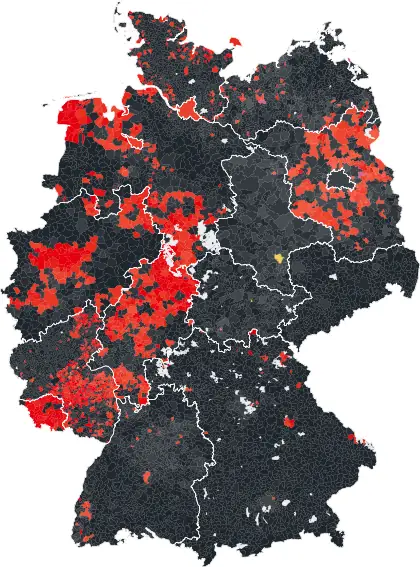
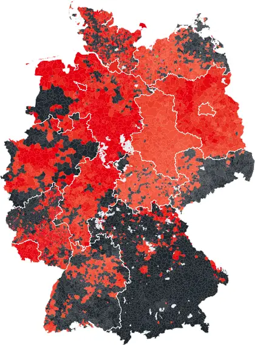
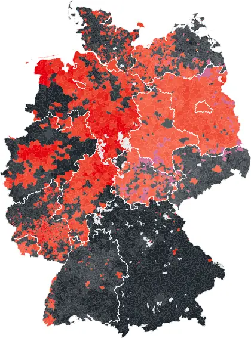
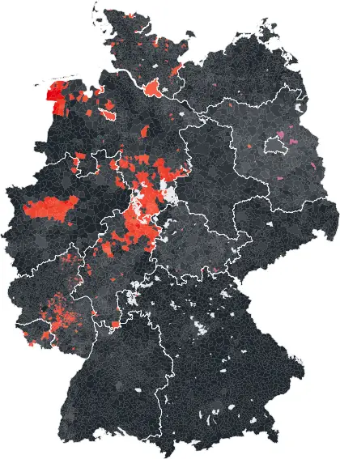
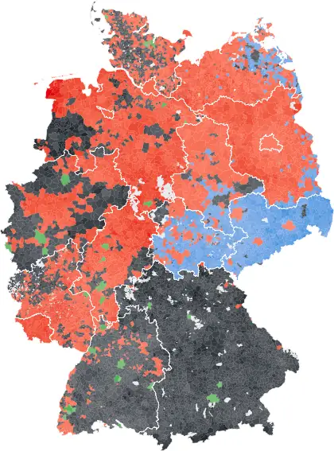
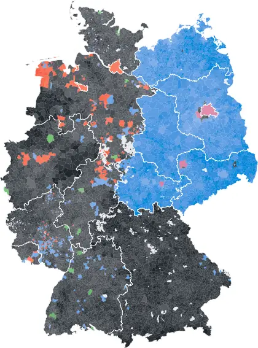

  <h1>German election results at the municipality, county and constituency level</h1>
  
Original and harmonized files support analyses of individual elections and comparisons over time.

<figure class="map-strip">
  

    <a class="map-strip-item" href="/dashboard/?year=1990&amp;show=winning_party" title="Open 1990 in the election explorer">1990</a>
    <a class="map-strip-item" href="/dashboard/?year=1998&amp;show=winning_party" title="Open 1998 in the election explorer">1998</a>
    <a class="map-strip-item" href="/dashboard/?year=2005&amp;show=winning_party" title="Open 2005 in the election explorer">2005</a>
    <a class="map-strip-item" href="/dashboard/?year=2013&amp;show=winning_party" title="Open 2013 in the election explorer">2013</a>
    <a class="map-strip-item" href="/dashboard/?year=2021&amp;show=winning_party" title="Open 2021 in the election explorer">2021</a>
    <a class="map-strip-item" href="/dashboard/?year=2025&amp;show=winning_party" title="Open 2025 in the election explorer">2025</a>
  

  <figcaption class="map-caption">
    
      <i style="background:#20262c"></i>CDU/CSU
      <i style="background:#E3000F"></i>SPD
      <i style="background:#0489DB"></i>AfD
      <i style="background:#BE3075"></i>Die Linke
      <i style="background:#1AA037"></i>Greens
      <i style="background:#e8c200"></i>FDP
    
    Leading party by municipality, on 2021 boundaries. Darker means a larger vote share. <a href="/dashboard/?show=winning_party">Explore all ten elections</a>
  </figcaption>
</figure>

  <h2 id="datasets">Election data</h2>
  
CSV &middot; Excel &middot; RDS

  <table class="home-table">
    <thead>
      <tr><th>Election series</th><th>Geography</th><th>Coverage</th><th>Files</th></tr>
    </thead>
    <tbody>
      <tr>
        <td>Federal electionsBundestagswahlen</td>
        <td>Municipalities, counties, constituencies</td>
        <td>1953&ndash;2025</td>
        <td>
<a href="/election-data/#federal-elections" aria-label="Download federal elections">Download</a><a href="/usage-notes/#federal-elections" aria-label="Documentation for federal elections">Documentation</a>
</td>
      </tr>
      <tr>
        <td>State electionsLandtagswahlen</td>
        <td>Municipalities, constituencies</td>
        <td>1946&ndash;2026</td>
        <td>
<a href="/election-data/#state-elections" aria-label="Download state elections">Download</a><a href="/usage-notes/#state-elections" aria-label="Documentation for state elections">Documentation</a>
</td>
      </tr>
      <tr>
        <td>Municipal electionsGemeinderats- und Stadtratswahlen</td>
        <td>Municipalities</td>
        <td>1969&ndash;2026</td>
        <td>
<a href="/election-data/#local-elections" aria-label="Download municipal elections">Download</a><a href="/usage-notes/#municipal-elections" aria-label="Documentation for municipal elections">Documentation</a>
</td>
      </tr>
      <tr>
        <td>European electionsEuropawahlen</td>
        <td>Municipalities</td>
        <td>2009&ndash;2024</td>
        <td>
<a href="/election-data/#european-elections" aria-label="Download european elections">Download</a><a href="/usage-notes/#european-elections" aria-label="Documentation for european elections">Documentation</a>
</td>
      </tr>
      <tr>
        <td>Mayoral electionsBürgermeisterwahlen</td>
        <td>Municipalities</td>
        <td>1945&ndash;2026</td>
        <td>
<a href="/election-data/#mayoral-elections" aria-label="Download mayoral elections">Download</a><a href="/usage-notes/#mayoral-elections" aria-label="Documentation for mayoral elections">Documentation</a>
</td>
      </tr>
      <tr>
        <td>Landrat electionsLandratswahlen</td>
        <td>Counties</td>
        <td>1945&ndash;2026</td>
        <td>
<a href="/election-data/#landrat-elections" aria-label="Download landrat elections">Download</a><a href="/usage-notes/#landrat-elections" aria-label="Documentation for landrat elections">Documentation</a>
</td>
      </tr>
      <tr>
        <td>County council electionsKreistagswahlen</td>
        <td>Municipalities, counties</td>
        <td>1948&ndash;2026</td>
        <td>
<a href="/election-data/#county-elections-kreistagswahlen" aria-label="Download county council elections">Download</a><a href="/usage-notes/#county-elections" aria-label="Documentation for county council elections">Documentation</a>
</td>
      </tr>
    </tbody>
  </table>

  

    <a href="/election-data/#additional-files">Crosswalks, boundaries and covariates</a>
    <a href="/meinungsbild/">Meinungsbild: opinion estimates for 43 policy issues</a>
  

  
Years refer to each series as a whole. Coverage varies by state, geography and file.

  

    <h2>Authors</h2>
    <ul class="author-list">
      <li><a href="https://vincentheddesheimer.github.io/">Vincent Heddesheimer</a></li>
      <li><a href="https://www.hannohilbig.com/">Hanno Hilbig</a></li>
      <li><a href="https://www.floriansichart.com/">Florian Sichart</a></li>
      <li><a href="https://www.abwiedemann.com/">Andreas Wiedemann</a></li>
    </ul>
  

  

    <h2>Citation</h2>
    
  

